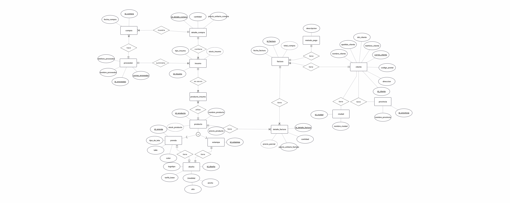

 <div align="center">

# NegocioIndumentariaDtf

### Sistema de gestión de datos para un negocio de indumentaria personalizada y estampados DTF

**Proyecto Integrador · Base de Datos I · 2026**


**Universidad Nacional del Nordeste**  
Facultad de Ciencias Exactas y Naturales y Agrimensura  
**Equipo 10 — CasiFunciona**

---

**[Documentación](docs/) · [Scripts SQL](sql/) · [Etapa V](docs/etapa-05/)**

</div>

---

## Índice

### Presentación del proyecto

- [Descripción del proyecto](#descripción-del-proyecto)
- [Objetivos y alcance](#objetivos-y-alcance)
- [Diseño de la base de datos](#diseño-de-la-base-de-datos)

### Desarrollo del proyecto por etapas

- [Desarrollo por etapas](#desarrollo-por-etapas)
  - [Etapa I — Requerimientos y dominio del negocio](#etapa-i--requerimientos-y-dominio-del-negocio)
  - [Etapa II — Modelado conceptual y lógico](#etapa-ii--modelado-conceptual-y-lógico)
  - [Etapa III — Implementación física](#etapa-iii--implementación-física)
  - [Etapa IV — Consultas SQL y explotación de datos](#etapa-iv--consultas-sql-y-explotación-de-datos)
  - [Etapa V — Funcionalidades avanzadas de SQL Server](#etapa-v--funcionalidades-avanzadas-de-sql-server)

### Funcionalidades avanzadas — Etapa V

- [Desarrollo técnico de la Etapa V](#funcionalidades-avanzadas--etapa-v)
  - [Procedimientos almacenados y funciones](#procedimientos-almacenados-y-funciones)
  - [Manejo de transacciones](#manejo-de-transacciones)
  - [Triggers de auditoría](#triggers-de-auditoría)
  - [Seguridad de la base de datos](#seguridad-de-la-base-de-datos)
  - [Índices y optimización de consultas](#índices-y-optimización-de-consultas)

### Documentación técnica y organización

- [Estructura del repositorio](#estructura-del-repositorio)
- [Instalación y ejecución](#instalación-y-ejecución)
- [Integridad y validación](#integridad-y-validación)
- [Tecnologías utilizadas](#tecnologías-utilizadas)
- [Organización del equipo](#organización-del-equipo)
- [Conclusión](#conclusión)

### Acceso directo a la documentación

| Etapa | Documentación |
|---|---|
| **Etapa I** — Requerimientos y dominio del negocio | [Ver documentación](docs/etapa-01/) |
| **Etapa II** — Modelado conceptual y lógico | [Ver documentación](docs/etapa-02/) |
| **Etapa III** — Implementación física | [Ver documentación](docs/etapa-03/) |
| **Etapa IV** — Consultas SQL | [Ver documentación](docs/etapa-04/) |
| **Etapa V** — Funcionalidades avanzadas | [Ver documentación](docs/etapa-05/) |

---

# Descripción del proyecto

**NegocioIndumentariaDtf** es un proyecto académico que consiste en el análisis, diseño e implementación de una base de datos relacional para un negocio dedicado a la comercialización de indumentaria personalizada y estampados mediante tecnología DTF (*Direct to Film*).

El propósito del proyecto es representar las operaciones principales del negocio mediante una estructura de datos organizada, que permita almacenar información, establecer relaciones entre entidades y realizar consultas de manera consistente.

El sistema contempla la administración de clientes, productos, prendas, estampas, diseños, proveedores, insumos, compras, facturas y métodos de pago.

## Problemática identificada

Un negocio de indumentaria personalizada necesita administrar información relacionada con diferentes operaciones comerciales.

Cuando los registros se encuentran dispersos o no existe una estructura definida, pueden producirse:

- Duplicación e inconsistencias de información.
- Errores en el registro de ventas y compras.
- Dificultades para consultar productos y proveedores.
- Problemas para relacionar facturas con sus detalles.
- Falta de control sobre los insumos utilizados.
- Dificultades para obtener información comercial.

## Solución propuesta

Se desarrolló una base de datos relacional que organiza la información en tablas vinculadas mediante claves primarias y foráneas.

Esta estructura permite representar las operaciones del negocio y aplicar restricciones destinadas a mantener la integridad de los datos.

---

# Objetivos y alcance

## Objetivo general

Diseñar e implementar una base de datos relacional para administrar la información de un negocio de indumentaria personalizada, aplicando los conceptos de modelado, normalización, implementación física, consultas SQL y administración de bases de datos.

## Objetivos específicos

- Analizar los requerimientos del negocio.
- Identificar las entidades y sus relaciones.
- Establecer las reglas de negocio.
- Elaborar el Diagrama Entidad-Relación.
- Transformar el modelo conceptual al modelo relacional.
- Aplicar las primeras tres formas normales.
- Implementar las tablas mediante T-SQL.
- Definir restricciones de integridad.
- Incorporar datos de prueba.
- Desarrollar consultas y reportes.
- Implementar procedimientos almacenados y funciones.
- Aplicar el manejo de transacciones.
- Utilizar triggers para registrar modificaciones.
- Administrar usuarios, roles y permisos.
- Analizar la optimización de consultas mediante índices.

## Alcance funcional

| Área | Funcionalidad |
|---|---|
| Clientes | Registro y consulta de información personal y de contacto. |
| Ubicación | Organización de provincias y ciudades. |
| Productos | Administración del catálogo comercial. |
| Prendas y estampas | Registro de características específicas. |
| Diseños | Administración de diseños relacionados con los productos. |
| Proveedores | Registro de información de proveedores. |
| Insumos | Administración de materiales utilizados. |
| Compras | Registro de adquisiciones y sus detalles. |
| Facturación | Registro de ventas y productos comercializados. |
| Métodos de pago | Identificación de los medios de pago. |
| Consultas | Obtención de información comercial. |
| Administración | Seguridad, auditoría y optimización de consultas. |

---

# Diseño de la base de datos

El diseño se desarrolló mediante tres niveles: conceptual, lógico y físico.

## Modelo conceptual

Se elaboró un **Diagrama Entidad-Relación (DER)** utilizando la notación de Peter Chen.

El modelo permitió representar las entidades, sus atributos, relaciones y cardinalidades antes de realizar la implementación en SQL Server.

<div align="center">

### Diagrama Entidad-Relación



[Ver diagrama completo](docs/etapa-02/DER/der.png)

</div>

## Modelo relacional

A partir del modelo conceptual se realizó la transformación al modelo relacional, definiendo tablas, atributos y claves.

La implementación física contiene **15 tablas**, organizadas según las operaciones del negocio.

| Área | Tablas |
|---|---|
| Ubicación y clientes | `PROVINCIA`, `CIUDAD`, `CLIENTE` |
| Medios de pago | `METODO_PAGO` |
| Catálogo de productos | `PRODUCTO`, `PRENDA`, `ESTAMPA`, `DISENO` |
| Proveedores e insumos | `PROVEEDOR`, `INSUMO`, `PRODUCTO_INSUMO` |
| Compras | `COMPRA`, `DETALLE_COMPRA` |
| Ventas | `FACTURA`, `DETALLE_FACTURA` |

### Decisiones de diseño relevantes

**Especialización de productos**

Se utilizó `PRODUCTO` como entidad general, vinculada con las entidades específicas `PRENDA` y `ESTAMPA`.

Esto permite organizar los atributos comunes y diferenciar las características particulares de cada tipo de producto.

**Organización de ubicaciones**

Se separó la información geográfica mediante las entidades `PROVINCIA` y `CIUDAD`, relacionadas con `CLIENTE`.

**Relaciones entre operaciones y detalles**

Se utilizaron tablas de detalle para representar los elementos que forman parte de las compras y las facturas.

**Relación entre productos e insumos**

La tabla `PRODUCTO_INSUMO` permite representar la asociación entre los productos y los materiales utilizados.

## Normalización

El modelo fue analizado aplicando las tres primeras formas normales:

| Forma normal | Aplicación |
|---|---|
| **1FN** | Organización de atributos con valores atómicos y eliminación de grupos repetitivos. |
| **2FN** | Análisis de dependencias funcionales para evitar dependencias parciales. |
| **3FN** | Revisión de dependencias transitivas y separación de información redundante. |

Este proceso contribuyó a mejorar la organización del modelo y reducir posibles anomalías en las operaciones sobre los datos.

**Documentación relacionada:**

- [Modelo relacional](docs/etapa-02/modelo-relacional.md)
- [Decisiones de diseño](docs/etapa-02/decisiones-diseno.md)
- [Proceso de normalización](docs/etapa-02/normalizacion.md)

---

# Desarrollo por etapas

El proyecto se encuentra organizado en cinco etapas, cada una relacionada con los contenidos desarrollados durante la asignatura.

## Etapa I — Requerimientos y dominio del negocio

**Objetivo:** comprender el funcionamiento del negocio y establecer las condiciones que debe cumplir la base de datos.

Se realizó el análisis inicial del sistema, identificando la problemática, los objetivos, el alcance y las reglas de negocio.

Durante esta etapa se elaboraron **31 reglas de negocio**, utilizadas como referencia para el diseño posterior.

| Documento | Descripción |
|---|---|
| [Requerimientos y dominio del negocio](docs/etapa-01/Requerimientos-y-dominio-del-negocio.md) | Contexto, problemática y alcance del proyecto. |
| [Reglas de negocio](docs/etapa-01/reglas-negocio.md) | Condiciones que regulan el funcionamiento del sistema. |

---

## Etapa II — Modelado conceptual y lógico

**Objetivo:** representar las entidades y relaciones del negocio y transformarlas en una estructura relacional.

Se elaboró el DER, se definieron las relaciones entre entidades y se aplicó el proceso de normalización.

| Documento | Descripción |
|---|---|
| [Diagrama Entidad-Relación](docs/etapa-02/DER/der.png) | Representación gráfica del modelo conceptual. |
| [Decisiones de diseño](docs/etapa-02/decisiones-diseno.md) | Justificación de las decisiones tomadas. |
| [Modelo relacional](docs/etapa-02/modelo-relacional.md) | Estructura lógica de la base de datos. |
| [Normalización](docs/etapa-02/normalizacion.md) | Aplicación de 1FN, 2FN y 3FN. |

---

## Etapa III — Implementación física

**Objetivo:** implementar el modelo relacional en Microsoft SQL Server.

Se desarrollaron scripts DDL para crear la base de datos y sus tablas, definiendo tipos de datos, claves y restricciones.

También se incorporaron datos de prueba mediante instrucciones DML y se documentaron las verificaciones realizadas.

| Recurso | Descripción |
|---|---|
| [Implementación física](docs/etapa-03/implementacion.md) | Desarrollo de la estructura de la base de datos. |
| [Restricciones de integridad](docs/etapa-03/restricciones-integridad.md) | Documentación de las restricciones aplicadas. |
| [Pruebas y validación](docs/etapa-03/pruebas-validacion.md) | Verificación de la implementación. |
| [Script DDL](sql/ddl/crear_bd.sql) | Creación de la base de datos y sus tablas. |
| [Script DML](sql/dml/datos_prueba.sql) | Inserción de datos de prueba. |

---

## Etapa IV — Consultas SQL y explotación de datos

**Objetivo:** recuperar y analizar información comercial mediante consultas SQL.

Se desarrollaron tres casos orientados a obtener información de las operaciones registradas.

### Comprobante de venta

Permite consultar los datos de una factura y los productos incluidos en ella.

### Consulta avanzada

Utiliza operaciones de combinación, agrupamiento y filtrado para analizar información comercial.

### Informe de ventas

Permite obtener información agrupada sobre las ventas registradas.

| Caso | Documentación | Script SQL |
|---|---|---|
| Comprobante de venta | [Ver documento](docs/etapa-04/comprobante-venta.md) | [Ver script](sql/consultas/comprobante_venta.sql) |
| Consulta avanzada | [Ver documento](docs/etapa-04/consulta-avanzada.md) | [Ver script](sql/consultas/consulta_avanzada.sql) |
| Informe de ventas | [Ver documento](docs/etapa-04/informe-ventas.md) | [Ver script](sql/consultas/informe_ventas.sql) |

**Documentación complementaria:** [Casos de uso](docs/etapa-04/Casos-uso.md).

---

## Etapa V — Funcionalidades avanzadas de SQL Server

**Objetivo:** estudiar y aplicar herramientas de programación, control de operaciones, auditoría, seguridad y optimización de bases de datos.

Se desarrollaron cinco temas, cada uno relacionado con una situación del sistema.

| Tema | Aplicación |
|---|---|
| Procedimientos y funciones | Actualización de stock y consulta del gasto acumulado de clientes. |
| Manejo de transacciones | Confirmación y cancelación de operaciones de venta. |
| Triggers de auditoría | Registro de cambios en los precios de productos. |
| Seguridad | Administración de usuarios, roles y permisos. |
| Índices y optimización | Análisis del rendimiento de consultas sobre datos históricos. |

**[Acceder a la documentación de la Etapa V](docs/etapa-05/)**

---

# Funcionalidades avanzadas — Etapa V

En esta etapa se investigaron diferentes herramientas de SQL Server Express y se desarrollaron ejemplos relacionados con el funcionamiento del negocio.

## Procedimientos almacenados y funciones

**Responsable:** Lucía Belén Fernández.

Los procedimientos almacenados permiten agrupar instrucciones SQL para ejecutar operaciones específicas.

Las funciones permiten realizar cálculos y devolver resultados que pueden utilizarse dentro de consultas.

### Aplicación al proyecto

**`sp_ActualizarStockInsumo`**

Procedimiento almacenado que permite incrementar la cantidad disponible de un insumo.

El ejemplo recibe el identificador del insumo y la cantidad que se desea agregar.

**`fn_TotalCompradoCliente`**

Función utilizada para consultar el importe acumulado de las compras realizadas por un cliente.

El repositorio incluye consultas que utilizan esta función para obtener el gasto histórico de los clientes.

### Archivos

- [Investigación](docs/etapa-05/procedimientos_funciones/investigacion.md)
- [Script del procedimiento](sql/tecnico/procedimiento.sql)
- [Consultas de la función](sql/tecnico/funcion.sql)

### Evidencias

| Evidencia | Archivo |
|---|---|
| Consulta de la función | [Ver imagen](docs/etapa-05/procedimientos_funciones/evidencias/funcion.png) |
| Stock antes del procedimiento | [Ver imagen](docs/etapa-05/procedimientos_funciones/evidencias/procedimiento_antes.png) |
| Stock después del procedimiento | [Ver imagen](docs/etapa-05/procedimientos_funciones/evidencias/procedimiento_despues.png) |

---

## Manejo de transacciones

**Responsable:** Pared Ifran Maitena.

El manejo de transacciones permite agrupar varias instrucciones SQL dentro de una unidad lógica de trabajo.

Su utilización resulta importante cuando una operación requiere modificar diferentes tablas relacionadas.

### Instrucciones utilizadas

- `BEGIN TRANSACTION`: inicia una transacción.
- `COMMIT TRANSACTION`: confirma los cambios.
- `ROLLBACK TRANSACTION`: cancela los cambios no confirmados.
- `TRY...CATCH`: permite controlar determinados errores durante la ejecución.

### Aplicación al proyecto

Se utilizó como ejemplo el registro de una venta mediante las tablas `FACTURA` y `DETALLE_FACTURA`.

Se realizaron tres pruebas:

| Prueba | Descripción | Resultado |
|---|---|---|
| **COMMIT** | Registro de una factura con dos productos. | Se confirmó una venta por $58.000. |
| **ROLLBACK** | Modificación temporal de la fecha de una factura. | Se recuperó la fecha original. |
| **ROLLBACK ante un error** | Inserción de un detalle con un producto inexistente. | Se canceló la transacción por una restricción de clave foránea. |

### Entorno utilizado

Las pruebas se realizaron en una base de práctica denominada `NegocioEstampadosEtapa3`.

Esta base contiene una estructura de facturación similar a la del proyecto, aunque presenta diferencias en los nombres de algunas columnas.

Por este motivo, el script documenta la demostración realizada en el entorno de práctica y no debe ejecutarse directamente sobre `NegocioIndumentariaDtf` sin adaptarlo.

### Archivos

- [Investigación sobre transacciones](docs/etapa-05/transacciones/investigacion.md)
- [Script SQL de las pruebas](sql/tecnico/transacciones.sql)
- [Documentación de evidencias](docs/etapa-05/transacciones/evidencias/README.md)

---

## Triggers de auditoría

**Responsable:** Lucía Belén Fernández.

Los triggers son objetos de SQL Server que permiten ejecutar instrucciones automáticamente cuando se producen determinados eventos sobre una tabla.

### Aplicación al proyecto

Se desarrolló un ejemplo de auditoría para registrar modificaciones realizadas sobre los precios de los productos.

El trigger utilizado se denomina:

`trg_AuditoriaCambioPrecio`

Su finalidad es registrar información relacionada con los cambios de precio.

La demostración contempla una tabla de auditoría denominada:

`AUDITORIA_PRECIO_PRODUCTO`

Esta permite conservar información sobre el producto modificado, los valores anteriores y nuevos, la fecha de la operación y el usuario correspondiente.

### Archivos

- [Investigación sobre triggers](docs/etapa-05/triggers_auditoria/investigacion.md)
- [Script SQL](docs/etapa-05/triggers_auditoria/script.sql)

### Evidencias

| Evidencia | Archivo |
|---|---|
| Estado anterior | [Ver imagen](docs/etapa-05/triggers_auditoria/evidencias/pre_trigger.png) |
| Estado posterior | [Ver imagen](docs/etapa-05/triggers_auditoria/evidencias/post_trigger.png) |
| Consulta de auditoría | [Ver imagen](docs/etapa-05/triggers_auditoria/evidencias/consulta_tabla_fantasma.png) |

---

## Seguridad de la base de datos

La seguridad permite controlar el acceso de los usuarios y determinar qué operaciones pueden realizar sobre la información almacenada.

### Aplicación al proyecto

Se trabajó con la creación de usuarios y roles para representar diferentes responsabilidades dentro del negocio.

Los perfiles utilizados en el ejemplo incluyen:

- Administrador.
- Empleado de ventas.
- Empleado de stock.

Se utilizaron instrucciones de T-SQL para crear usuarios, asignar roles y establecer permisos.

Entre ellas se encuentran:

`CREATE LOGIN`, `CREATE USER`, `CREATE ROLE`, `ALTER ROLE` y `GRANT`.

### Archivos

- [Investigación sobre seguridad](docs/etapa-05/seguridad/seguridad.md)
- [Script SQL](sql/tecnico/seguridad.sql)

**Consideración de seguridad:** las credenciales incluidas en scripts de demostración deben reemplazarse por contraseñas seguras antes de utilizarse en un entorno real.

---

## Índices y optimización de consultas

**Responsable:** Malena Ayelén Fabregat.

La optimización de consultas busca mejorar la eficiencia con la que SQL Server recupera información.

Los índices pueden facilitar el acceso a los registros, aunque también requieren recursos de almacenamiento y mantenimiento.

### Aplicación al proyecto

Se desarrolló una demostración utilizando una tabla de prueba denominada:

`FACTURA_HISTORICA`

El script contempla la generación de un conjunto de datos de hasta **1.000.000 de registros** para comparar el comportamiento de consultas con diferentes condiciones de indexación.

Se analizaron aspectos como:

- Índices agrupados y no agrupados.
- Recorridos de tablas.
- Búsquedas mediante índices.
- Lecturas lógicas.
- Tiempo de ejecución.
- Planes de ejecución.

Para obtener estadísticas se utilizaron instrucciones como:

```sql
SET STATISTICS TIME ON;
SET STATISTICS IO ON;
```

Estas herramientas permiten observar el comportamiento de las consultas y evaluar el efecto de los índices.

### Archivos

- [Investigación sobre índices](docs/etapa-05/indices/indices-optimizacion.md)
- [Script SQL de optimización](sql/tecnico/indices.sql)

---

# Estructura del repositorio

El repositorio se encuentra organizado en dos directorios principales:

- **`docs/`**: documentación académica correspondiente a las cinco etapas.
- **`sql/`**: scripts de creación, inserción, consultas y funcionalidades avanzadas.

La estructura principal es la siguiente:

```text
proyecto-bd1-casifunciona-10-/
│
├── docs/
│   ├── etapa-01/
│   │   ├── Requerimientos-y-dominio-del-negocio.md
│   │   └── reglas-negocio.md
│   │
│   ├── etapa-02/
│   │   ├── DER/
│   │   │   └── der.png
│   │   ├── decisiones-diseno.md
│   │   ├── modelo-relacional.md
│   │   └── normalizacion.md
│   │
│   ├── etapa-03/
│   │   ├── implementacion.md
│   │   ├── pruebas-validacion.md
│   │   └── restricciones-integridad.md
│   │
│   ├── etapa-04/
│   │   ├── Casos-uso.md
│   │   ├── comprobante-venta.md
│   │   ├── consulta-avanzada.md
│   │   └── informe-ventas.md
│   │
│   └── etapa-05/
│       ├── procedimientos_funciones/
│       │   ├── investigacion.md
│       │   └── evidencias/
│       │
│       ├── transacciones/
│       │   ├── investigacion.md
│       │   └── evidencias/
│       │
│       ├── triggers_auditoria/
│       │   ├── investigacion.md
│       │   ├── script.sql
│       │   └── evidencias/
│       │
│       ├── seguridad/
│       │   └── seguridad.md
│       │
│       └── indices/
│           └── indices-optimizacion.md
│
├── sql/
│   ├── ddl/
│   │   └── crear_bd.sql
│   │
│   ├── dml/
│   │   └── datos_prueba.sql
│   │
│   ├── consultas/
│   │   ├── comprobante_venta.sql
│   │   ├── consulta_avanzada.sql
│   │   └── informe_ventas.sql
│   │
│   └── tecnico/
│       ├── procedimiento.sql
│       ├── funcion.sql
│       ├── transacciones.sql
│       ├── seguridad.sql
│       └── indices.sql
│
├── .gitignore
├── proyecto-bd1-casifunciona-10-.slnx
└── README.md
```

Esta organización permite separar los documentos explicativos del código SQL y facilita la revisión de los archivos correspondientes a cada etapa.

---

# Instalación y ejecución

## Requisitos

Para trabajar con el proyecto se recomienda disponer de:

- Microsoft SQL Server.
- SQL Server Management Studio (SSMS).
- Una instancia de SQL Server con permisos para crear bases de datos.
- Los archivos del repositorio.

---

# Integridad y validación

Durante el desarrollo del proyecto se aplicaron mecanismos para mantener la consistencia de la información.

## Integridad de entidad

Se definieron claves primarias para identificar los registros de las tablas.

## Integridad referencial

Se utilizaron claves foráneas para establecer relaciones entre las entidades.

Estas restricciones permiten impedir determinadas operaciones que generarían referencias a registros inexistentes.

## Integridad de dominio

Se utilizaron tipos de datos y restricciones para controlar los valores almacenados.

Entre los mecanismos implementados se encuentran:

- `PRIMARY KEY`
- `FOREIGN KEY`
- `UNIQUE`
- `NOT NULL`
- `CHECK`

## Verificación mediante pruebas

Las pruebas permiten comprobar el comportamiento de las restricciones y las operaciones SQL.

En la Etapa V, por ejemplo, se documentó una transacción que intentaba registrar un detalle de venta con un producto inexistente.

SQL Server detectó una infracción de clave foránea y la operación fue cancelada mediante `ROLLBACK`.

Este ejemplo permite relacionar el manejo de transacciones con la integridad referencial.

**Documentación complementaria:**

- [Restricciones de integridad](docs/etapa-03/restricciones-integridad.md)
- [Pruebas y validación](docs/etapa-03/pruebas-validacion.md)

---

# Tecnologías utilizadas

| Tecnología | Aplicación |
|---|---|
| **Microsoft SQL Server** | Sistema gestor de bases de datos relacional. |
| **SQL Server Express** | Entorno utilizado para implementar y probar funcionalidades. |
| **SQL Server Management Studio** | Administración y ejecución de scripts SQL. |
| **T-SQL** | Definición, manipulación y consulta de datos. |
| **ERDPlus** | Elaboración del modelo conceptual y relacional. |
| **Git** | Control de versiones. |
| **GitHub** | Organización del repositorio y trabajo colaborativo. |
| **Markdown** | Documentación técnica y académica. |

---

# Organización del equipo

## Equipo 10 — CasiFunciona

**Universidad:** Universidad Nacional del Nordeste  
**Facultad:** Facultad de Ciencias Exactas y Naturales y Agrimensura  
**Asignatura:** Base de Datos I  
**Ciclo lectivo:** 2026

### Integrantes

| Integrante |
|---|
| Niveyro, Lucía |
| Pared Ifran, Maitena |
| Fernández, Lucía Belén |
| Fabregat, Malena Ayelén |

---

# Conclusión

El desarrollo de **NegocioIndumentariaDtf** permitió aplicar de manera progresiva los conocimientos adquiridos durante la asignatura.

A lo largo de las cinco etapas trabajamos en el análisis de requerimientos, la definición de reglas de negocio, el modelado conceptual y lógico, la normalización y la implementación física de una base de datos relacional.

Posteriormente, desarrollamos consultas SQL para obtener información comercial y trabajamos con funcionalidades avanzadas de SQL Server, como procedimientos almacenados, funciones, transacciones, triggers de auditoría, seguridad y optimización mediante índices.

Estas actividades nos permitieron comprender que el desarrollo de una base de datos no consiste solamente en almacenar información, sino también en organizarla correctamente, establecer relaciones, mantener su integridad y controlar las operaciones realizadas.

Además, el uso de GitHub facilitó la documentación y el trabajo colaborativo, permitiendo reunir los aportes individuales en un mismo proyecto.

Como resultado, el repositorio integra los documentos y scripts correspondientes a las cinco etapas, representando una aplicación práctica de los contenidos de la asignatura a un negocio de indumentaria personalizada.

---

<div align="center">

### NegocioIndumentariaDtf

**Proyecto Integrador — Base de Datos I**

**Equipo 10 — CasiFunciona**

Facultad de Ciencias Exactas y Naturales y Agrimensura  
Universidad Nacional del Nordeste

**2026**

---

*Análisis · Modelado · Implementación · Consultas · Administración*

</div>
